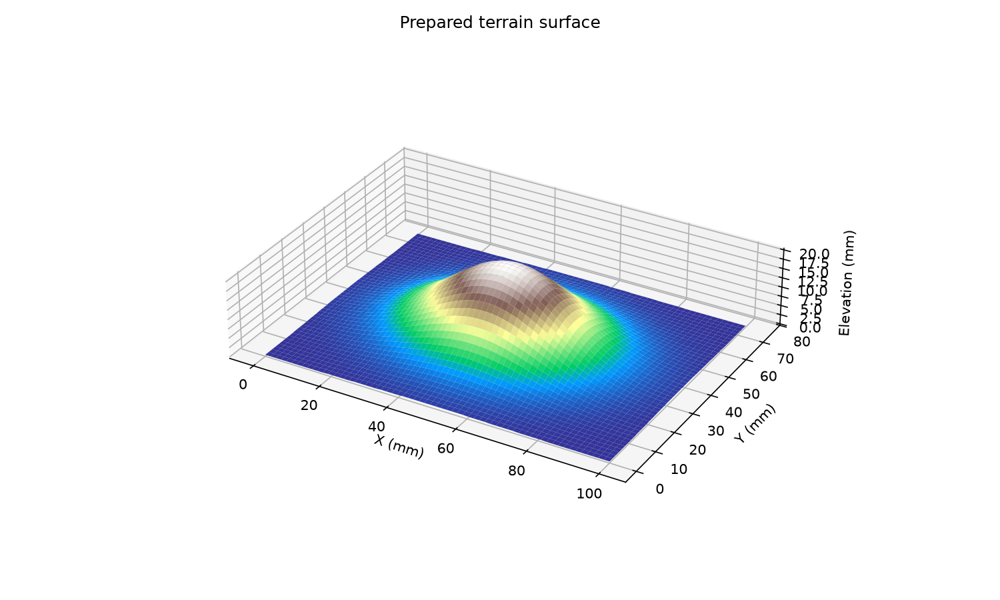

# Heightmap terrain mesh

Turn a grayscale image into a closed terrain STL, with control over its physical size and height. The program prepares the image, builds the top, bottom, and side walls, then checks the resulting mesh before saving it.



## Try it

Use Python 3.11 or newer. From this folder:

```sh
python -m venv .venv
# Windows: .venv\Scripts\activate
# macOS / Linux: source .venv/bin/activate
python -m pip install -r requirements.txt
python sample_heightmap.py
python terrain.py heightmap.png --width-mm 100 --relief 20 --base-thickness 3 --preview preview.png
```

This produces `terrain.stl`, `terrain.json`, and `preview.png`. The sample is a generated hill, not a measured geographic dataset. Open the STL in a slicer to inspect it before printing.

## Size, resolution, and height

```sh
python terrain.py heightmap.png --width-mm 150 --relief 25 --base-thickness 4 --max-size 128 --smooth 1.5
python terrain.py heightmap.png --crop 10 5 40 30 --width-mm 80 --relief 12 --output cropped.stl
python terrain.py heightmap.png --spacing 0.5 --height-scale 0.05 --base -2
```

| Option | Meaning |
| --- | --- |
| `--width-mm` | Total width in millimeters; depth follows the cropped image's grid aspect ratio |
| `--spacing` | Distance between original pixel centers when width is not specified; defaults to 1 mm |
| `--relief` | Map the prepared image's minimum to 0 and maximum to this height in millimeters |
| `--height-scale` | Height per intensity level when relief is not specified; defaults to 0.1 |
| `--base-thickness` | Put the bottom this far below the lowest prepared elevation |
| `--base` | Absolute bottom Z when base thickness is not specified; defaults to -5 mm |
| `--max-size` | Maximum grid dimension, default 256; smaller values reduce file size |
| `--smooth` | Gaussian sigma in original image pixels, applied before resampling |
| `--crop` | Input rectangle as X, Y, width, height; each dimension must be at least two pixels |
| `--report` | Optional JSON report location; otherwise saved beside the STL |

Resampling preserves the requested physical footprint. For example, a 201×101 image at 1 mm spacing spans 200×100 mm even if reduced to a much smaller grid. Pixel centers define the boundary, so an unscaled W×H image spans `(W-1) × (H-1)` intervals. X follows image columns and Y follows image rows; the image is not flipped.

Both 8-bit and 16-bit grayscale PNGs retain their intensity precision. Color images are converted to grayscale. For 16-bit maps, `--relief` is often easier to use than the default per-intensity height scale. A constant image becomes flat when normalized. For geographic terrain, the input must already be an elevation raster; a picture with contour lines is not decoded into elevations. No map projection or real-world elevation lookup is performed.

## Geometry and checks

Every grid cell has two top triangles and two bottom triangles. Boundary edges receive side-wall triangles. The STL uses outward winding and a flat bottom. The base must be strictly below the lowest point.

Before export, `mesh_checks.py` counts unique edges, checks shared-edge directions, rejects degenerate triangles, and computes signed volume. The report includes the bounds, dimensions, surface area, triangle count, grid spacing, and volume in millimeter units. A successful check requires a closed, consistently wound surface with positive signed volume. These topology checks do not perform a general self-intersection analysis or certify printer settings.

The preview shows the prepared top surface, not the full solid base. Dimensions and volume in the report describe the entire solid. STL coordinates are interpreted as millimeters by this program; STL itself does not store unit metadata.

The construction uses explicit loops to keep the geometry easy to follow. A 256×256 grid contains roughly 262,000 triangles. Higher resolution takes more memory during edge checking, so raise `--max-size` only when the detail is useful.

## Python API

```python
from heightfield import load_heightmap, prepare
from terrain import build_terrain
from mesh_checks import inspect_mesh

image = load_heightmap('heightmap.png')
heights, spacing = prepare(image, width_mm=100, relief=20, max_size=128)
solid = build_terrain(heights, spacing=spacing, height_scale=1, base=-3)
print(inspect_mesh(solid))
solid.save('terrain.stl')
```

## Tests

```sh
python -m pip install -r requirements-dev.txt
python -m pytest -q
```

Tests check analytical block volume, STL round trips, opposite shared-edge winding, physical size after resampling, 16-bit input, normalization, cropping, smoothing, invalid options, and detection of open or reversed faces. GitHub Actions runs the same suite.
